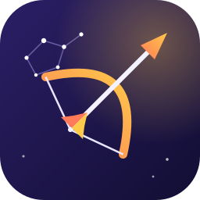

<p align="center">
  
</p>

# Sagitario Language

Sagitario is a compiled systems programming language that combines Rust-like safety
(no null, `Result` errors, `match`) with TypeScript/Java/C#-style classes and JavaScript-style
functional programming. It uses automatic reference counting, compiles to portable C11, and
aims to run on every desktop and mobile platform and eventually compile itself.

> **Status:** the desktop MVP (phases F0–F2) works: modules, structs, enums and `match`,
> classes with inheritance, interfaces, generics, closures, lists, maps and iterators, compiled
> to C11 with ARC. The [reference zoo program](tests/run-pass/reference_zoo/main.sag) shows them
> together. Concurrency, mobile targets and self-hosting come later (see the
> [roadmap](docs/roadmap.md)).

```sag
abstract class Animal {
  prv const name: String;

  pub fn new(self, name: String) { self.name = name; }
  pub fn display_name(self) -> String { self.name }
  pub abstract fn speak(self) -> String;
}

class Dog extends Animal {
  pub fn new(self, name: String) { zod.new(name); }
  pub override fn speak(self) -> String { `${self.display_name()} says woof` }
}

fn main() {
  const dog = new Dog("Rex");
  println(dog.speak());
}
```

## Documentation

- [Language specification](docs/spec/README.md)
- [Design decisions (ADRs)](docs/adr/README.md)
- [Compiler architecture](docs/architecture.md)
- [Roadmap](docs/roadmap.md)
- [Contributing](CONTRIBUTING.md)

## License

Licensed under either of [MIT](LICENSE-MIT) or [Apache-2.0](LICENSE-APACHE), at your option.
